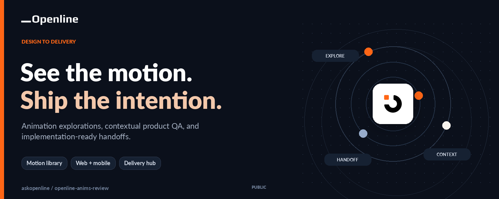
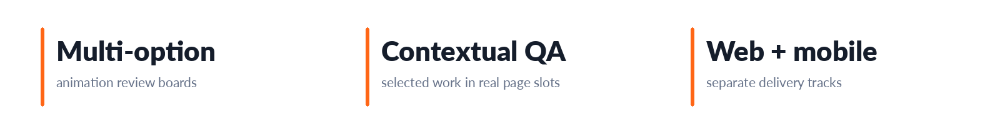
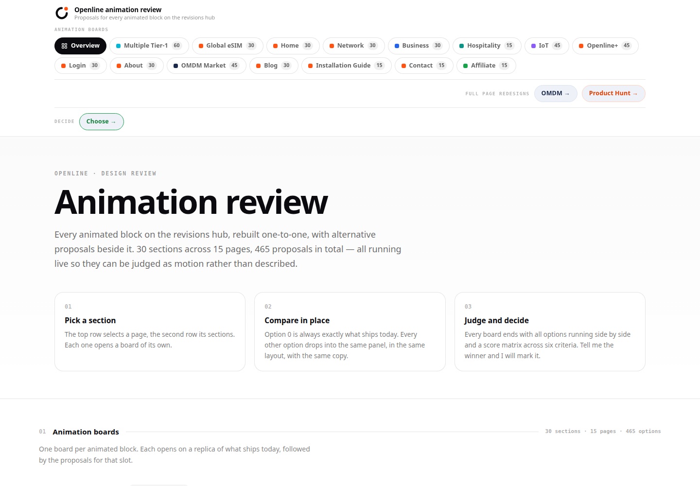
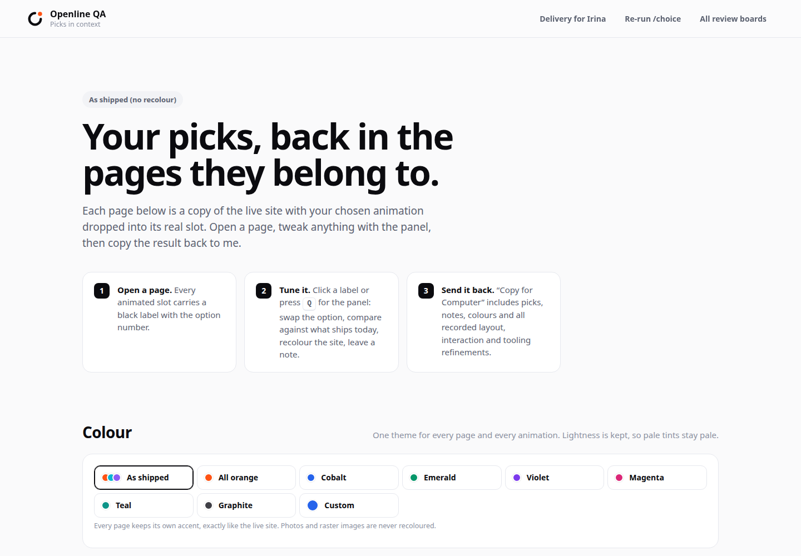
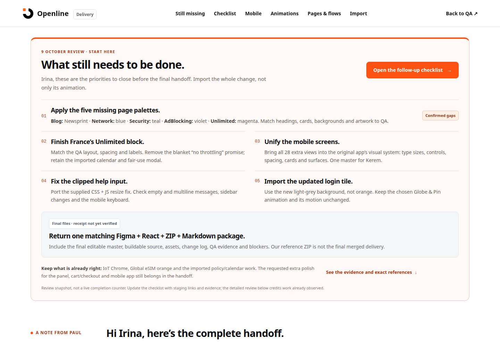
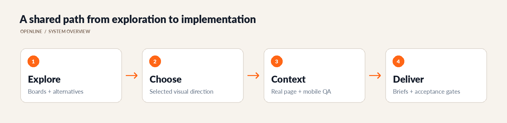

# Openline Design Review

<!-- CUP-OF-NEWS-STYLE -->
<div align="center">

[](https://openline.com)
[](https://github.com/askopenline/openline-anims-review)
[](https://github.com/askopenline/openline-anims-review/releases)
[](#development)




**Animation explorations, contextual product QA, and implementation-ready handoffs.**

[Company website](https://openline.com) · [Project overview](https://openline-anims-review.vercel.app) · [Release history](https://github.com/askopenline/openline-anims-review/releases) · [Contribution guide](.github/OPENLINE-CONTRIBUTING.md)

</div>

---

A shared workspace for deciding how Openline should look, move, and behave. Animation explorations, contextual page reviews, mobile references, and engineering handoffs live together so that a selected direction can survive the journey into implementation.

<p align="center">
  <a href="https://openline-anims-review.vercel.app"><strong>Open the review workspace</strong></a> ·
  <a href="https://openline-anims-review.vercel.app/qa">Contextual QA</a> ·
  <a href="https://openline-anims-review.vercel.app/delivery">Delivery hub</a> ·
  <a href="#development">Run locally</a> ·
  <a href="https://github.com/askopenline/openline-anims-review/releases">Releases</a>
</p>



---

## Explore, compare, decide

The review library lets the team compare alternatives before committing to a direction. Its scope extends from individual animated blocks to complete product journeys and full-page concepts.

| Area | What you can review | Entry point |
| --- | --- | --- |
| Animation boards | Alternative treatments for network, eSIM, product, and company stories | [Review hub](https://openline-anims-review.vercel.app) |
| Product surfaces | Home, Network, Business, Hospitality, IoT, Openline+, About, and related pages | Review-hub navigation |
| Contextual QA | Chosen animations placed back into their intended page slots | [`qa/`](qa/) |
| Journey concepts | Purchase, redemption, installation, activation, plan selection, and support references | [`start.html`](start.html), [`qa/`](qa/) |
| Full-page concepts | OMDM Market and Product Hunt presentation work | [`omdm.html`](omdm.html), [`producthunt.html`](producthunt.html) |
| Mobile references | Source and built views for the separate mobile implementation track | [`mobile-src/`](mobile-src/), [`mobile/`](mobile/) |
| Delivery and acceptance | Implementation scope, imports, checklists, packages, and verification gates | [`delivery/`](delivery/) |

---

## See the workspace

The captures below come from this repository running locally. They show the actual review and delivery interfaces, rather than decorative product mockups.



| Selected designs in context | Implementation handoff |
| --- | --- |
|  |  |

---

## From a visual direction to a shipped implementation



The review environment is a reference and decision tool. The integrated website and native app must still satisfy their own acceptance criteria against real services and real device behavior.

- **Explore:** Compare motion, hierarchy, pacing, and interaction alternatives before selecting a treatment.
- **Choose:** Record the intended version so that implementation does not accidentally reuse an abandoned option.
- **Contextualize:** Review the selection inside its destination page, including real text lengths and mobile constraints.
- **Hand off:** Use the matching brief, packaged runtime, import guide, and checklist.
- **Verify:** Test the resulting product integration, not only the visual reference.

---

## Delivery reference

| Document | Use it for |
| --- | --- |
| [`delivery/brief.md`](delivery/brief.md) | Web implementation scope and priorities |
| [`delivery/import-guide.md`](delivery/import-guide.md) | Importing the runtime and packaged work |
| [`delivery/acceptance.md`](delivery/acceptance.md) | Acceptance and production-verification gates |
| [`delivery/checklist-guide.md`](delivery/checklist-guide.md) | Tracking implementation and review |
| [`delivery/mobile-handoff.md`](delivery/mobile-handoff.md) | The separate mobile implementation track |
| [`delivery/followup-2026-10-09.md`](delivery/followup-2026-10-09.md) | Dated follow-up clarifications |

Web/shop integration and mobile implementation are intentionally separate workstreams. A completed web preview is not evidence that the corresponding native flow, provisioning behavior, or backend integration has been accepted.

---

## Development

The included Node server mirrors the clean-URL behavior used by the review workspace. Use a current Node.js runtime that supports the server's module APIs.

```sh
git clone https://github.com/askopenline/openline-anims-review.git
cd openline-anims-review
node delivery/serve.mjs
```

Open [the local review hub](http://localhost:8080), [contextual QA](http://localhost:8080/qa), or [the delivery hub](http://localhost:8080/delivery). Set `PORT` when another application already uses port 8080.

For the mobile source:

```sh
cd mobile-src
npm ci
npm run dev
# Build a reviewed mobile preview:
npm run build
```

```text
openline-anims-review/
├── index.html                Review entry point
├── js/ and css/              Shared review behavior and presentation
├── qa/                       Selected work in destination-page context
├── delivery/                 Handoff materials and local server
├── mobile-src/               Mobile reference source
└── mobile/                   Built mobile reference
```

---

## Review checklist

- **Motion:** Check pacing, loops, transitions, and reduced-motion behavior.
- **Layout:** Inspect desktop and mobile widths, long text, focus states, and content overflow.
- **Interaction:** Exercise the actual controls and distinguish demonstrations from connected workflows.
- **Assets:** Keep the selected design, supporting captures, and packaged downloads synchronized.
- **Integration:** Validate authentication, purchase codes, activation, payments, provisioning, and account state in the real product where relevant.

---

## Releases and contributions

[GitHub releases](https://github.com/askopenline/openline-anims-review/releases) identify reviewed company snapshots, while the [company changelog](OPENLINE-CHANGELOG.md) explains the current edition. Editing source does not automatically rebuild every handoff ZIP or replace a collaborator's existing checkout.

Use the [contribution guide](.github/OPENLINE-CONTRIBUTING.md) for changes and the [security guide](.github/OPENLINE-SECURITY.md) for sensitive reports. Product enquiries belong at [Openline](https://openline.com/contact), not in a public issue containing customer information.

---

## Design and technology choices

### Compare before integrating

Alternative treatments stay visible in a review environment, where motion and hierarchy can be judged before application code is committed to one direction.

### Context before acceptance

An animation can look excellent in isolation and fail inside a real page. Contextual QA exposes the surrounding copy, spacing, navigation, and mobile constraints.

### Reference plus handoff

The delivery hub connects the visual decision with imports, checklists, and acceptance questions so the chosen direction remains understandable to implementers.

---

## Ownership and asset context

Openline maintains the original review work, designs, and company documentation in this repository. Operator marks, AI-provider icons, and other external resources retain their own rights; inclusion does not establish a commercial relationship.

The [operator notes](qa/assets/operators/README.md), [AI-provider notes](qa/assets/ai/README.md), and [portrait notes](qa/assets/support-portraits/README.md) describe those boundaries. Illustrative support portraits and simulated product states should not be presented as staff photography or production-service evidence.
